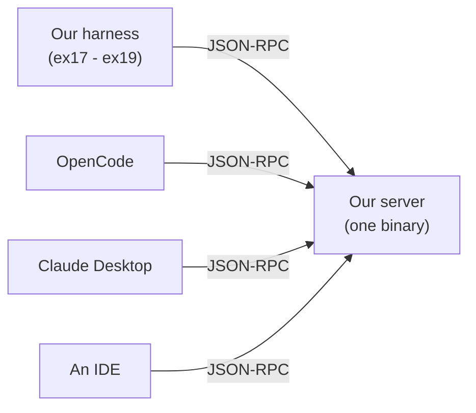

# Writing MCP Servers

We've spent a whole section *using* MCP servers - spawning them, negotiating the protocol by hand,
listing their tools, and routing the model's calls through them. Now we turn around and write one.

The reason is the one we kept bumping into: a server written once can be used by our chat client,
by OpenCode, by Claude Desktop, by an IDE, or by whatever comes next. We don't teach every new
agent about our particular API - we write one server and everybody speaks it.

Here's the encouraging part. We already know the protocol, because we wrote the client side of it
by hand. We know it's JSON-RPC, that tools are described by a name, a description, and a JSON
Schema, and that calling one is just a `tools/call` round trip. Writing a server is that
conversation from the other end - and the official Rust SDK removes almost all of the boilerplate.

So this section is mostly ordinary Rust: a struct, some methods, and a `main` that picks a
transport. We'll cover:

* the official Rust SDK, and how to add it;
* a minimal server, end to end;
* tools, resources, and prompts - the three things a server can expose;
* the two transports, `stdio` and Streamable HTTP;
* errors and logging (there's one trap here that catches everybody);
* testing a server before wiring it into anything;
* plugging it into a harness;
* and the security story, which changes shape now that *we're* the server.

> If you haven't read the client-side MCP chapters yet, do those first. This section assumes you
> know what `initialize`, `tools/list`, and `tools/call` look like, because we're about to answer
> them instead of sending them.
