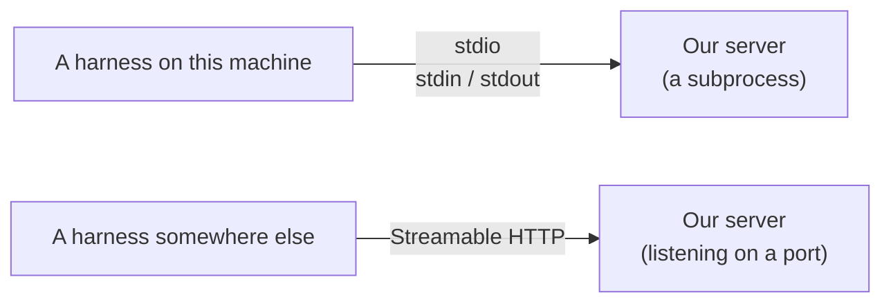

# Transports: stdio and Streamable HTTP

In the client chapters we learned the central trick: MCP is one protocol with two ways of carrying
it. The messages don't change - only the plumbing does. That's just as true when we're the server.
We write one handler, and choose how it's reached.



## stdio

This is what we've used all along. The harness launches our binary as a subprocess and talks over
stdin and stdout. The `stdio()` transport is the whole setup:

```rust
let service = Calculator.serve(stdio()).await?;
service.waiting().await?;
```

Its virtues are that there's no port, no TLS, and no configuration: the harness knows the command
and owns the process. Its limits are that it's local to one machine and one client - and, again,
that **stdout is the protocol channel**, so nothing else may write to it. Diagnostics go to stderr.

## Streamable HTTP

For a server that other machines (or several clients) should reach, use Streamable HTTP. Enable
the feature:

```toml
rmcp = { version = "3", features = ["server", "transport-streamable-http-server"] }
```

and serve over HTTP instead of stdio. The same `ServerHandler` runs underneath; only the transport
changes. The modern spec is deliberately *stateless* by default, which is what makes it easy to run
several instances behind a load balancer - and each client only sees the tools you advertise.

The costs are the ones you'd expect from any web service: TLS, authentication, and a decision
about who is allowed to reach it. The SDK includes OAuth support behind the `auth` feature for the
cases that need it, but "put it behind the same gateway as everything else, with the same
permissions" is usually the right first answer.

## Which one?

* **stdio** for a tool you run alongside one harness - a local file server, a project-specific
  helper, a desktop assistant.
* **Streamable HTTP** for anything shared, remote, or multi-client.

Our client from `ex17`-`ex19` speaks both, and the Inspector does too, so you can develop against
stdio and move the same handler to HTTP later without rewriting it. That portability is the whole
reason the protocol keeps the messages and the transport separate.
