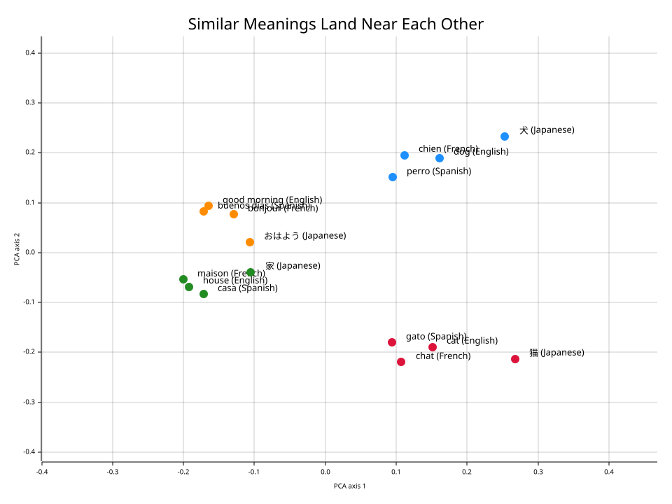

# Searching by Meaning

> This is in the repo as `ex24_embeddings`.

So far every search we've talked about matches *letters*. Ask for "house" and you get pages that
contain the string `house` - and nothing else. That's fine until someone writes "property", or
"home", or "casa", or a language you didn't think of.

To search by meaning we need to turn text into something a computer can compare numerically. That
something is a **vector**: a long list of numbers. Run two pieces of text through the same model and
you get two vectors, and if the model is any good, texts that mean similar things land near each
other.

## The Model

We use [`fastembed`](https://github.com/Anush008/fastembed-rs) to run the model locally - no API key,
no per-call cost, and it works offline once the model is cached. The model is
[`intfloat/multilingual-e5-small`](https://huggingface.co/intfloat/multilingual-e5-small), which
produces a `384`-number vector for each input.

An embedding model is **not** a chat model. It doesn't answer you. It reads text and hands back one
vector. That's the entire job, and it's a different job from generating tokens - which is why it gets
its own model rather than being "the LLM, but smaller".

## The Pipeline

1. text goes in,
2. the model's tokenizer breaks it into tokens,
3. the model produces a `384`-dimensional vector,
4. we compare vectors with cosine similarity,
5. we project them down to two dimensions so we can draw them.

That last step is because a `384`-dimensional vector is useful to a program and useless to your
eyeball. **Principal component analysis (PCA)** finds the two directions the data varies along most,
and those two numbers become our x and y. It's a teaching aid: nearby points on the plot are usually
genuinely related, but collapsing `384` dimensions into `2` distorts distances, so don't treat the
picture as the truth.

## A Small Detail That Matters

If you print what the model actually received, you'll notice it isn't `cat`:

```text
cat (English)
  model input: "query: cat"
  token ids: [0, 41, 1294, 12, 7515, 2]
  tokens: ["<s>", "▁que", "ry", ":", "▁cat", "</s>"]
```

The E5 family expects a prefix: `query: ` for the thing you're searching *for*, and `passage: ` for
the things you search *over*. Getting those the right way round is one of those small things that
quietly costs you quality if you forget. The tokenizer is also model-specific - it is not the same
tokenizer as any other model we've used, and it happily splits a word into pieces.

## The Payoff

Here's the plot the example generates:



Four ideas - cats, dogs, houses and greetings - each written in four languages. The colours cluster.
`cat`, `gato`, `chat` and `猫` are nowhere near each other as strings, and yet:

| Pair | Cosine similarity |
|---|---|
| `cat` <-> `chat` | `0.9296` |
| `house` <-> `casa` | `0.9529` |
| `dog` <-> `perro` | `0.9203` |
| `good morning` <-> `buenos días` | `0.8799` |
| `cat` <-> `house` | `0.8787` |
| `good morning` <-> `犬` | `0.7963` |

A score near `1` means the vectors point in almost the same direction. Same-meaning pairs cluster up
near `0.9`; the "wrong" pairs sit lower - even when they share no characters at all.

But do look honestly at the bottom of that table. `cat` and `house` score `0.8787`: unrelated short
words are still fairly close. That isn't the model being broken. It's a small model, these are tiny
inputs, and "semantic space" is a useful approximation, not a crystal of perfect truth. When you look
at scores like these, ask "are the related pairs *more* related than random spelling would explain?"
- not "is every unrelated pair near zero?"

## Running It

```bash
cd code/ex24_embeddings
cargo run
```

The first run downloads the model into your cache (a couple of hundred megabytes); after that it's
local. The program prints the tokenization and similarity tables above and writes the plot to
`output/embeddings.svg`.

Next, we turn "which of these two vectors is closer" into an actual search.
