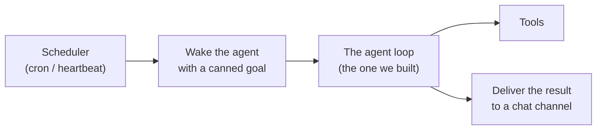

# It's Just Cron and a Heartbeat

Tools like **Hermes** (from Nous Research) and **OpenClaw** are open-source, self-hosted "personal
assistant" agents. You point them at a chat platform, give them tools, and leave them running.
They'll send you a briefing at 7am, watch a web page for changes, triage your inbox, and generally
act like a tireless colleague.

It's easy to be impressed by this, and just as easy to be intimidated by the amount of machinery
involved. But strip it back and the interesting part is small: at their heart these are a
**scheduler** wrapped around the exact agent loop we built in `ex20_agent`.

Two scheduling primitives do almost all the work:

* **Cron.** Run a job at an exact time ("9am every Monday"), or on some interval, usually in a
  fresh, isolated session. This is `cron(5)` with a prompt attached.
* **Heartbeat.** A periodic turn in an *existing* session - often every 30 minutes - where the
  agent wakes up, reads a short checklist, and decides whether anything needs attention. If nothing
  does, it stays quiet (`HEARTBEAT_OK`, `[SILENT]`, and similar conventions exist purely to avoid
  spamming you).

Once you see that, the rest is plumbing: a long-running gateway daemon ticks the schedule, a
synthetic message wakes the agent, and the agent's output is delivered to a channel instead of a
terminal.

The loop hasn't changed. `run_goal` doesn't care whether the goal came from a human, a cron
expression, or a heartbeat checklist. An "always-on assistant" is our loop, plus a timer, plus
delivery, plus somewhere to keep its memory between ticks.

Two consequences are worth holding onto. First, scheduling, persistence, and delivery are the
*hard* parts once you go beyond a demo - not the reasoning. Second, if a job is fully determined by
a script, these systems will happily run it with **no model at all** (Hermes calls this `no_agent`
mode). Even the companies selling always-on agents know when not to use one.

> Which is also the security story. An agent that wakes up by itself, reads untrusted messages, and
> can send things on your behalf is a prompt injection away from doing it unattended. The
> provenance chapters stop being theoretical the moment you put the loop on a timer.
