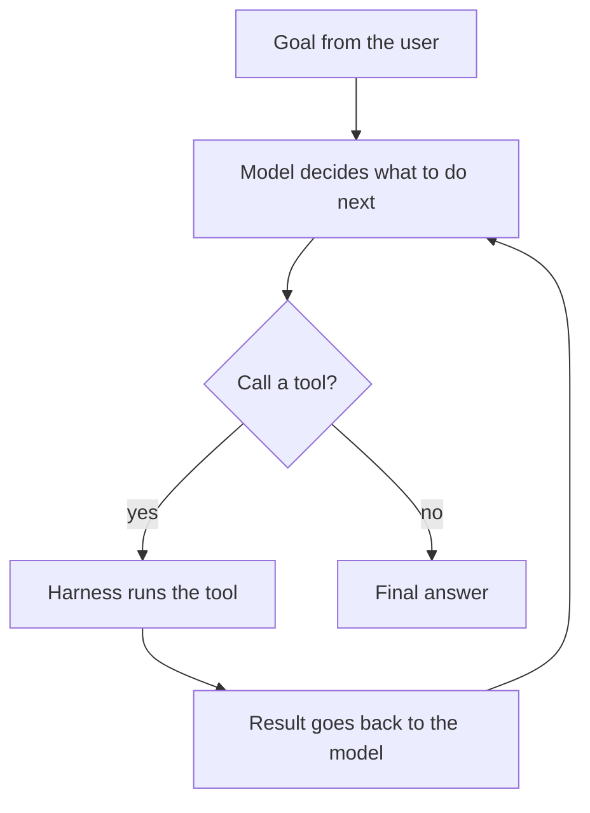

# The Agentic Loop

Everything we've built so far has a person at the wheel. You type a message, the model answers -
possibly calling a tool or two on the way - and then it stops and waits for you to type again.
Even the tool loop from `ex08`, which can make several calls before it replies, is still answering
a single prompt from a human.

An *agent* turns that around. You give it a **goal**, not a prompt: "find out what port the deploy
service listens on", or "work out why the build keeps failing." It then decides for itself which
tools to call, reads what comes back, and uses those results to choose its next move. It keeps
going until it can answer, and then it stops.

That is the whole trick, and it's worth deflating a little. There's no magic ingredient here - it
is the same `tools` array and the same `tool_call` round trip we've been using since `ex08`. What
changes is *who drives the loop*.

| Chatbot | Agent |
| ------- | ----- |
| You choose the turns | The model chooses the turns |
| Answers one prompt | Pursues one goal |
| Stops and waits for you | Stops when it's finished |

The `Call -- "no"` branch is the natural exit: the model replies with no tool calls, so there's
nothing left to do. But models also get stuck. A confused agent will happily call the same tool
with the same arguments forever, burning tokens and your patience. So a careful harness puts a
**hard limit** on the number of iterations and stops regardless of what the model wants. The best
agents are the ones you can switch off.

The other thing to notice is that multi-turn thinking is what makes this useful. A single call can
only use what it already knows. An agent can *find something out*, and then act on it - search a
note, discover it points at another note, follow the reference, and only then answer. Each step is
chosen in light of the last. That's the benefit, and it's what we'll build next.
